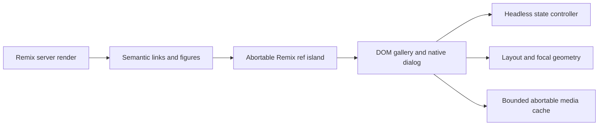

# Interactive gallery architecture

## Verified framework and scope

The repository initially contained only the specification. Node 24.22.1 and npm 11.19.1 are available. Locally installed Remix 3.1.0 exposes `remix/component`, `remix/component/server`, `ref`, `createElement`, and `renderToString`. Official documentation: https://docs.remix.run/component/ . The upstream changelog shows conflicting newer UI names; this implementation pins 3.1.0 and verifies installed exports rather than assuming React or Remix 2 conventions. No React dependency.

## Boundaries

Use one ESM package with separate exports instead of ten tiny packages. Core and geometry have no DOM dependencies; DOM owns interaction, media, layout and modal lifetime; the optional Remix adapter uses an abortable ref island. Optional extensions load independently.

## Contracts and state

Images have stable unique IDs, safe source URLs, alt text, intrinsic dimensions, title, category, optional srcset and sizes. Controller owns item order, active ID and selected IDs, emits immutable snapshots, accepts append/update/remove/reorder and filter operations. Invalid IDs never become active. Subscribers explicitly unsubscribe. Destroy aborts work.

Public modules: core, geometry, media, dom, remix3, extensions. DOM mount returns destroy; no browser globals are evaluated at module load. Server rendering escapes all text and exposes real detail links. Browser island enhances existing markup without reconciling its children. Route URLs use /image/:id and /category/:category. History stores modal IDs; popstate restores viewer state without pushing again. Closing restores the invoking control when still connected.

## Rendering and lifecycle

Native dialog provides top-layer modality, inert background and focus containment; explicit Tab handling and focus restoration supplement it. AbortController scopes listeners; ResizeObserver disconnects on teardown. Pointer capture arbitrates pinch, pan and swipe. Zoom clamps to 1–8, preserves focal coordinates, bounds pan and resets between items. CSS columns preserve DOM reading order but visual column order differs from rows; grid is available. WAAPI FLIP snapshots occur only around layout changes, never in pointer hot paths. Reduced motion disables animation and autoplay.

Virtualized mode uses fixed estimated rows, overscan, stable IDs and pinned focused items; variable-height masonry virtualization is intentionally unsupported. Large datasets use grid windowing. Unknown dimensions default to 4:3. Native lazy images and neighboring decode use bounded cache; signed URLs are provider responsibilities and never logged.

## Budgets and concurrency

Target default entry under 35 KiB gzip excluding optional Remix runtime; windowed 10,000-item views under 120 mounted tiles; no perpetual animation loop. Measure build sizes, layout computation p95/p99 and browser long tasks. Device FPS, LCP, decode memory and slow-network budgets require real-device profiling and must not be inferred from synthetic timing. Async media uses AbortSignal and generation checking; cache limits decoded entries. No worker until profiling demonstrates need.

## Security and accessibility

Only http(s) and same-origin relative image URLs are accepted; optional origin allowlist. Captions use text nodes. No raw SVG, HTML injection or automatic download/share requests. CSP should allow self scripts/styles and explicitly chosen image hosts; remote providers must configure CORS. Native buttons have names, visible focus, 44px targets, live announcements; keyboard Escape/arrows/Home/End/+/-/0 and RTL inversion. Meaningful images work without JS. Manual screen-reader, touch, forced-color and 200% text audits remain necessary.

## Tests and alternatives

Node tests cover controller, geometry, cancellation, virtualization and URL validation. Playwright verifies real SSR, keyboard modal focus, history, filtering, zoom, RTL, responsive and reduced-motion states, cleanup and screenshots. Benchmarks report actual measured values. A heavyweight animation library and React adapter were rejected to avoid runtime coupling. Deep zoom, annotations and before/after are optional extension contracts rather than decoding gigapixel images. Full production accessibility certification and device performance are outside automated verification.

## Implemented audit addendum

The final host uses `remix/router` `createRouter`, explicit GET handlers, standard Request/Response and `router.fetch`, verified against the installed 3.1.0 routing guide and source. Dot-delimited route parameters require `/media/:file.svg`; the route tests caught and corrected an initial assumption that `:file` captured the extension. Browser hydration uses `createRoot` with a `Handle<Props>` component. Browser-only observers and dialogs are allocated only inside mount/ref initialization.

The DOM controller now integrates the bounded provider cache and decode-before-display, supports independent consumer cancellation, stale generation guards and retry. Gesture geometry is cached outside move events, momentum decays by elapsed time and is cancelled on navigation/unmount. Measured thumbnail geometry supplies opening animation when compatible; closing now uses a cancellable reverse morph/fade and restores focus after completion. Windowing reuses mounted nodes, pins focused tiles and adjusts scroll position when the column count changes. Core query/group/tag/selection and async pagination remain separate from DOM rendering. Responsive picture sources and srcset use protocol validation; estimates are explicit through `estimateImage`.

Optional extensions include synchronized comparison, before/after, slideshow and annotations. Deep zoom is implemented in a separately loaded module with bounded tile planning, fetch/decode concurrency, encoded cache budgets and object URL cleanup. Full-resolution gigapixel sources are blocked in ordinary SSR/viewer thumbnails. Rubber-band overscroll, spring profiles and reverse closing transitions are implemented. Benchmarks include Node data/layout timing, compressed entries, browser frame/DOM/heap observations and throttled synthetic JPEG decode stress. Neither JS heap nor estimated pixel bytes is a native-memory measurement. Manual assistive technology and real-device certification are outstanding.

## Completion pass design

Deep zoom is a separate `/deep-zoom` module and dynamic demo chunk. A pyramid descriptor contains full image dimensions, tile size and an abortable tile provider; it never contains or fetches a full-resolution source. A pure planner selects a resolution from screen pixel density and zoom, computes only intersecting tiles plus bounded overscan, and reduces the level if the tile budget is exceeded. The DOM adapter caps mounted tiles, active fetch/decode jobs, encoded cache bytes and entries. View changes abort obsolete work; disposal revokes all tile object URLs. A provider may return a Blob for authenticated/synthetic tiles or a validated HTTP(S) URL fetched with AbortSignal and same-origin credentials. JPEG/PNG/WebP/AVIF tiles only; arbitrary SVG and HTML are rejected. The demo synthesizes individual raster tiles from global coordinates, so no gigapixel bitmap is allocated.

Closing keeps native dialog modality and scroll lock until its measured reverse animation completes. A generation token cancels obsolete completion callbacks on reopening/navigation; teardown bypasses animation. Missing/offscreen/incompatible targets fade, and reduced motion closes synchronously. Geometry is read only at transition boundaries, not during pointer movement. Motion profiles configure duration/easing/zoom/overscroll; rubber-band presentation remains separate from bounded logical pan.

### Completion pass validation

The completion pass implements reduced-data neighbor loading, progressive/plugin placeholders, configurable container layout options, full-access bounded rails, accessible ordering, custom renderers/transitions and lazy extension demos. Both library and demo now undergo strict TypeScript/no-unused checks. Transition callbacks are generation-safe and animation cancellation resolves obsolete close operations without closing a reopened viewer. Deep-zoom tests instrument object URLs and assert zero retained URLs after teardown. Signed tile URLs never enter diagnostics; remote tile redirects are rejected. Optional image/video/panorama adapters remain isolated; untrusted inline SVG uploads are not supported. Firefox full shared integration and dedicated WebKit 27.2 integration tests pass. Missing WebKit codec/controller dependencies are installed locally from pinned Ubuntu packages; only WebKit receives the scoped preload environment. Native fullscreen UI and real assistive technologies remain manual verification items.

### WebKit compatibility corrections

Comparison panning ignores pointer-down events originating on interactive descendants, preserving native button activation on annotation controls. Deep zoom marks scheduled renders busy immediately and includes pending animation-frame work in readiness announcements, preventing stale tile jobs from advertising a completed view before the new one renders. Dedicated WebKit tests exercise those cases with real pointer events, plus JPEG decoding, bounded tile cleanup, closing races, no-JS routes, RTL/mobile and axe checks. Runtime setup and test execution are reproducible without changing system or Playwright-managed libraries.

### Shared Firefox integration coverage

Portable gallery, lifecycle, extension, resource-budget and codec assertions run through shared scenario functions, with required engine-specific launchers. Firefox has its own visual baselines; Chromium baselines remain unchanged. Playwright does not expose Chromium CDP touch injection for Firefox, so Firefox multi-pointer recognition is exercised through explicitly reported synthetic Pointer Events while normal mouse and single-touch activation use Playwright input. Desktop viewport, touch capability, reduced motion and forced colors are tested without claiming unsupported Firefox isMobile emulation. Engine-specific diagnostics and results are written separately to avoid overwriting Chromium measurements.

### Shared WebKit integration coverage

WebKit uses the same required gallery and feature runners as Chromium and Firefox, alongside its codec/lifecycle integration suite. The launcher retains the scoped local runtime. Seven WebKit-specific visual baselines isolate engine rendering differences; normal verification never rewrites them. Mouse and single-touch activation use Playwright input, while multi-pointer recognizer tests explicitly report synthetic Pointer Events because Playwright exposes no native WebKit multi-touch injector.

### Requirement audit corrections

The current requirement matrix is in docs/requirement-audit.md. Origin constraints
are enforced before SSR image markup and within controller validation, so rejected
dynamic updates cannot leave committed data outside the renderer's policy. SSR and
DOM share the configured decode ceiling. Mutations use batched pre/post layout
measurements and cancelable FLIP animations in the reusable DOM adapter rather than
only the demo. The adapter cancels outstanding reflow on reduced-motion changes and
teardown. History records an instance owner while preserving host state; disabled
history never follows popstate. Replacing a direct deep-link URL does not acquire a
pushed entry, so closing cannot spuriously navigate Back. Modal focus traversal
includes custom interactive metadata; editing keys retain native semantics.

Chromium now uses the same required gallery, feature/resource and codec/lifecycle
suites as Firefox and WebKit, through a shared engine-validated launcher. The
throttled benchmark records mouse-click handler to two-frame opportunities as a
latency proxy, explicitly excluding OS input delay and display presentation timing.
